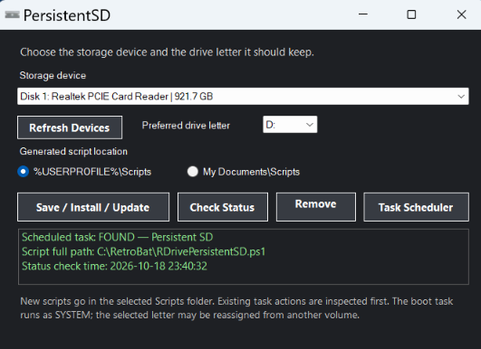

# PersistentSD

**Keep your chosen drive letter assigned to the storage device you want.**

A lightweight Windows utility designed to configure a preferred drive letter and maintain that assignment with a scheduled task at startup.

[Download latest release](https://github.com/Cutter81/PersistentSD/releases) · [Report a problem](https://github.com/Cutter81/PersistentSD/issues)

> [!IMPORTANT]
> **Drive-letter safety:** The current runtime script checks whether the preferred letter is already assigned to a partition. If another partition owns it, PersistentSD logs the conflict and leaves that volume and its drive letter untouched. It does not force the reassignment. Always double-check the selected disk and preferred letter before installing.

## What PersistentSD is designed to do

PersistentSD gives you a Windows Forms interface for selecting a storage disk and the drive letter you want it to use. It saves your preferences and sets up a PowerShell script to run through a scheduled task at startup under the **SYSTEM** account, helping reapply the chosen letter to the intended disk.

The manager uses the Windows disk `UniqueId` to identify the selected device rather than relying only on its current drive letter. It also provides controls to install or update the task, check its status, open Task Scheduler, and remove the task.

## At a glance

- **Choose the device** from the detected Windows storage disks.
- **Choose a preferred letter** from D: to Z:.
- **Install or update** a startup task that runs as SYSTEM.
- **Check status** to inspect the scheduled task and the script it runs.
- **Manage the task** from the app, including opening Task Scheduler or removing the task.
- **Keep a safety trail** with backups of scripts being replaced and logs from the runtime script.

## Get started

### Option 1 — Download the release

1. Open the [PersistentSD releases page](https://github.com/Cutter81/PersistentSD/releases).
2. Download the ZIP attached to the release you intend to use.
3. Extract the ZIP to a folder you can keep in place.
4. Keep `PersistentSD.exe` and `PersistentSD.ps1` together in that extracted folder, then run the manager as **Administrator**.

The ZIP includes the application, script template, license, and quick-start instructions. You do not need to download the EXE or script separately.

### Option 2 — Build from source

**Requirements:** Windows and the .NET Framework C# compiler (`csc.exe`).

1. Download or clone this repository.
2. Keep `PersistentSD.ps1` beside the source and build files.
3. Run `Build-PersistentSD.bat` on Windows.
4. After a successful build, launch `PersistentSD.exe` as **Administrator**.

The build script looks for the .NET Framework compiler in the standard 64-bit and 32-bit Windows locations.

## How to use it

1. Open PersistentSD as Administrator.
2. Refresh the device list and select the intended storage device.
3. Select the preferred drive letter (**D:** through **Z:**).
4. Choose one of the offered Scripts folders.
5. Select **Save / Install / Update** and read the confirmation prompts carefully.
6. Use **Check Status** to review the registered task and script path.

Task Scheduler can also be opened from the app if you want to inspect the task directly.

## Safety and behavior

| Area | What to know |
| --- | --- |
| **Device matching** | The script is designed to match the selected disk using its Windows `UniqueId`. If it cannot find exactly one matching disk, it should make no drive-letter changes. |
| **Partition selection** | The script is designed to skip system, boot, and recovery partitions. Among eligible data partitions on the selected disk, it prefers one already using the chosen letter, then one with an existing drive letter, then the first eligible partition. |
| **Protected partitions** | System, boot, and recovery partitions are intended to be excluded from reassignment. |
| **Existing drive letters** | If another partition already owns the preferred letter, the runtime script leaves it untouched and retries later. It does not remove the other partition's letter. |
| **Backups** | Existing target scripts are backed up before replacement. When changing script locations, the previously referenced script is backed up where applicable. |
| **Old files** | Previous scripts are not automatically deleted. Verify the new setup before manually removing any old copies. |
| **Failures** | Backups are retained if a later step fails; do not assume the app has automatically rolled everything back. |
| **Disk state** | The script does not automatically bring an offline disk online or clear its read-only flag. |
| **Logging** | Runtime activity is written to `PersistentSD.log`. |

Preferences are stored at `%LOCALAPPDATA%\PersistentSD\preferences.txt`. The startup task runs as **SYSTEM**, so its configured script must remain at the registered path and accessible to that account.

## Project files

| File | Purpose |
| --- | --- |
| `PersistentSDManager.cs` | Windows Forms configuration interface and scheduled-task management |
| `Build-PersistentSD.bat` | Builds the Windows application |
| `PersistentSDManager.exe.manifest` | Requests administrator privileges |
| `RazorBlade.ico` | Application icon |
| `PersistentSD.ps1` | PowerShell script template used by the manager |
| `PersistentSD.png` | Application screenshot displayed above |

## Testing notes

This README describes the software's intended behavior and documented safeguards; it is not a claim that every Windows version, disk layout, or failure scenario has been exhaustively tested. Before installing or updating the startup task, verify the selected disk and current drive-letter assignments, and read each confirmation prompt carefully.

## Feedback

Found a bug or have a suggestion? [Open an issue on GitHub](https://github.com/Cutter81/PersistentSD/issues).

---

*PersistentSD — a small utility for keeping storage paths predictable.*

